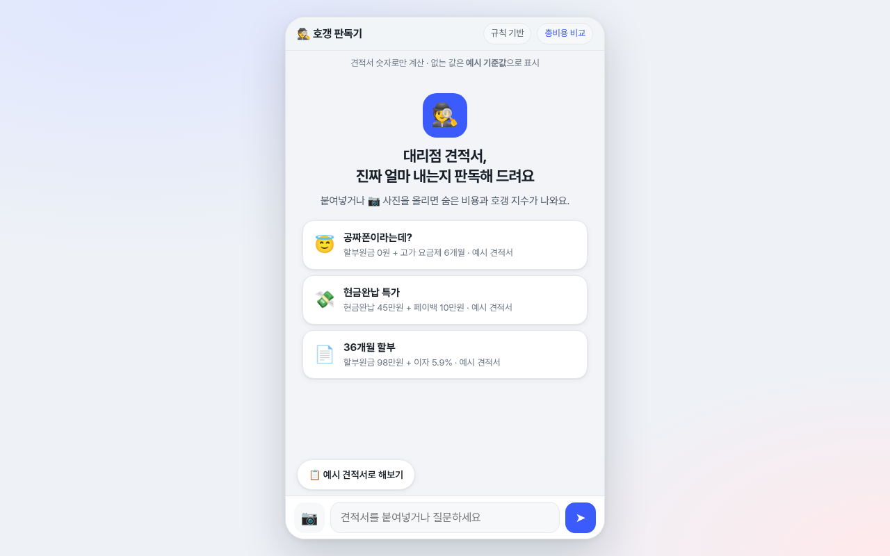
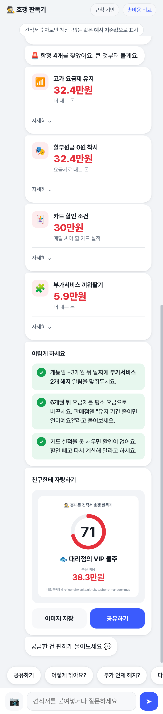

# 🕵️ 휴대폰 견적서 호갱 판독기

대리점 휴대폰 견적서를 붙여넣거나 사진으로 올리면, **24개월 실제 총비용**, 견적서에 안 보이는 **숨은 비용**, 함정 목록, **호갱 지수(0~100)** 를 채팅으로 알려주는 정적 웹앱입니다.

> **English summary** — A static, client-side web app that reads a Korean phone-dealer quote (pasted text or photo via in-browser OCR), computes the real 24-month cost and the hidden cost behind headlines like "할부원금 0원", flags common traps, and produces a shareable "rip-off score" card. No server, no build step. MIT licensed.

- **라이브 데모:** https://jeonghwanko.github.io/phone-manager-mvp/
- **바로 결과 보기:** https://jeonghwanko.github.io/phone-manager-mvp/#demo
- 총비용 비교(기기변경·번호이동·자급제): [`compare.html`](https://jeonghwanko.github.io/phone-manager-mvp/compare.html)

| 데스크톱 | 모바일 결과 |
|---|---|
|  |  |

## 무엇을 하나요
- 견적서 텍스트 붙여넣기 또는 📷 사진 업로드 (브라우저 안에서 tesseract.js 한국어 OCR)
- 항목 해석: 출고가, 할부원금, 현금완납, 요금제와 유지 기간, 이후 요금, 부가서비스 개수·금액·기간, 카드 할인 조건, 할부 이자, 페이백
- 24개월 실제 총액과 숨은 비용 계산, 함정별 카드(요금제 유지, 0원 착시, 부가서비스, 이자, 카드 실적, 페이백)
- 호갱 지수와 칭호, 공유 이미지(저장 / `navigator.share` / 클립보드)
- "이렇게 하세요" 다음 행동, 후속 질문에 답하는 규칙 기반 상담

## 작동 방식
1. `quote.js`의 `parse()`가 정규식으로 견적서 숫자를 뽑습니다.
2. `calc()`가 계산합니다.
   - 실제 총액 = 24개월 안에 내는 기기 금액 + 할부 이자 + 통신요금 + 부가서비스 − 페이백
   - 숨은 비용 = 실제 총액 − 견적서 기기 금액 − 평소 요금 × 24개월
   - 호갱 지수 = 숨은 비용 7천원당 1점 + 함정 1개당 4점 (최대 100)
3. `detect.js`가 결과를 짧은 말풍선과 카드로 차례로 보여줍니다.

## 파일 구조
```
index.html     호갱 판독기 (메인)
hogang.css     메인 화면 디자인 (Pretendard, 다크 모드)
NOTICE.md      서드파티 라이선스 고지
quote.js       견적서 파서 + 계산기 (브라우저/Node 공용)
detect.js      채팅 UI, OCR, 공유 카드, 후속 상담
compare.html   예전 총비용 비교 채팅 (engine.js, parse.js, app.js, data.json)
admin.html     견적 요청·알림 CRM(localStorage) + 선택적 LLM 설정
style.css      compare/admin 화면 스타일
test.js        node 테스트
docs/          스크린샷
```

## 로컬에서 실행
빌드가 필요 없습니다.
```bash
git clone https://github.com/jeonghwanko/phone-manager-mvp.git
cd phone-manager-mvp
python3 -m http.server 8000   # http://localhost:8000
node test.js                  # 파서·계산기 테스트
```

## 공개 운영 설정
- `config.js`: `OPERATOR_NAME`, `CONTACT_EMAIL`, `LEAD_ENDPOINT`, `GA_ID` (모두 비어 있으면 문의는 GitHub 이슈, 견적 요청은 이용자 기기에만 저장, 분석 도구 미사용)
- 견적 요청을 Google 시트로 받기: [docs/lead-sheet-setup.md](docs/lead-sheet-setup.md)
- [이용약관](terms.html) · [개인정보처리방침](privacy.html)
- 견적서 사진 OCR은 브라우저 안에서 실행되며 사진은 서버로 올라가지 않습니다.

## 데이터 주의사항
- 계산은 **사용자가 넣은 견적서 숫자**로만 합니다. 실제 판매점·통신사 데이터가 아닙니다.
- 견적서에 없는 값(평소 요금, 부가서비스 월 금액, 할부 이자율)만 `quote.js`의 `REF` **예시 기준값**을 쓰고 화면에 표시합니다.
- `compare.html`의 `data.json` 숫자도 모두 **예시 데이터 (실제 조건 아님)** 입니다.
- 정규식 파서라 형식이 특이한 견적서나 OCR 결과는 일부 항목을 놓칠 수 있습니다. 계약 전 실제 조건을 꼭 확인하세요.

## 선택: LLM 연결
`admin.html?admin`의 "AI 연결"에 OpenAI 호환 `chat/completions` 엔드포인트·키·모델을 넣으면, 후속 질문이 계산 결과와 함께 그 엔드포인트로 전송됩니다. 없거나 실패하면 규칙 기반 답변으로 돌아갑니다.

> ⚠️ **키 노출 주의:** 키는 브라우저 localStorage에 저장되고 브라우저에서 직접 호출됩니다. 공개 배포에서는 그 브라우저를 쓰는 누구나 키를 볼 수 있으니, **키를 숨기는 서버 프록시**를 엔드포인트로 쓰세요. 저장소에는 어떤 키도 들어 있지 않습니다.

## 기여하기
이슈와 PR 환영합니다. 특히 실제 견적서 문구 예시(개인정보 제거)로 파서를 개선하는 기여가 큰 도움이 됩니다. PR 전에 `node test.js`를 통과시켜 주세요.

## 라이선스
[MIT](LICENSE) © 2026 Lucas Ko · 서드파티 고지: [NOTICE.md](NOTICE.md)
